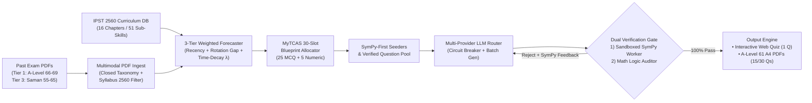

# Predict A-Level Math 1 — Neuro-Symbolic Exam Forecasting & Verified Mock Studio

<p align="center">
  <a href="#english">English</a> •
  <a href="#ภาษาไทย">ภาษาไทย</a> •
  <a href="#human-vs-ai-engineering-ownership">Human vs. AI Roles (EN)</a> •
  <a href="#บทบาทของคน-vs-ai-human-vs-ai-roles">บทบาทของคน vs AI (TH)</a>
</p>

> A production-grade **Neuro-Symbolic AI system** that forecasts sub-skill distributions for Thailand's **TCAS A-Level Applied Mathematics 1 (Subject Code 61)** using a **3-Tier Weighted Multi-Source model**, and synthesizes **100% SymPy-verified** exam papers in official A-Level A4 PDF format.
>
> ระบบ **Neuro-Symbolic AI** สำหรับทำนายสัดส่วนทักษะย่อยข้อสอบ **TCAS A-Level คณิตศาสตร์ประยุกต์ 1 (รหัสวิชา 61)** ด้วยโมเดลถ่วงน้ำหนัก 3 ชั้น (3-Tier Weighted Multi-Source) พร้อมสร้างข้อสอบจำลองที่ **ตรวจคำตอบด้วย SymPy 100%** ออกมาเป็นไฟล์ A4 PDF มาตรฐานข้อสอบจริงและโหมดฝึกทำบนหน้าเว็บ

---

<a id="english"></a>
## English

### Why This Project Exists

Standard LLMs fail on high-stakes high-school math exam generation in three predictable ways:
1. **Contradictory / Impossible Premises** (e.g., requiring $x \neq 0$ while $\det(C) = 8x^3 = 0$, or conflicting mean and median constraints).
2. **Arithmetic & Algebraic Hallucinations** (claiming an answer key that does not match the stated equation, or leaking hedging text like *"adjusting the numbers"*).
3. **Curriculum Drift & Broken LaTeX** (including deprecated topics removed from Thailand's IPST 2560 curriculum, or JSON-corrupted escapes like `\t` eating `\times`).

This project solves all three by **strictly separating probabilistic generation (LLM) from deterministic symbolic verification (SymPy)** and grounding exam composition in **zero-leakage historical backtesting**.

### System Architecture



### Walk-Forward Ablation Backtest (Zero Leakage)

Evaluated chronologically on real **A-Level Math 1 (2568 & 2569)** exams (`224` verified real questions ingested across Tier 1 & Tier 3). Both model fitting (`exam_year_be < test_year`) and marginal probability scaling (`expected_hits` estimated strictly from past training folds) enforce **zero evaluation leakage**.

| Model | Description | Recall@10 | Recall@15 | Brier Score *(lower is better)* | Log-Loss |
| :--- | :--- | :---: | :---: | :---: | :---: |
| `naive_uniform` | Uniform prior across all 51 sub-skills | 0.8000 | 0.6333 | 0.23803 | 0.66917 |
| `model_a_tier1` | Tier 1 only (A-Level 66–69 + rotation gap) | 0.8500 | 0.8334 | 0.23591 | 1.25631 |
| `model_b_tier1_tier2` | Tier 1 + IPST 2560 Curriculum Universe | 0.8500 | 0.8334 | 0.22059 | 1.01647 |
| **`model_c_full_3tier`** | **Tier 1 + Tier 2 + Time-Decayed Tier 3 (Winner)** | **0.8000** | **0.8334 (+20.0%)** | **0.21555 (-9.4%)** | **0.97946** |

> **Key Takeaway:** Naive equal-weight pooling across old and new exams hurts calibration, whereas **time-decayed 3-tier weighting (`model_c_full_3tier`)** reduces Small-N variance, achieves the lowest Brier Score (`0.21555`), and lifts `Recall@15` by **+20 percentage points** over the baseline.

### Core Engineering Highlights

- **Neuro-Symbolic Dual Verification Gate ([`src/verifier.py`](src/verifier.py)):**
  - **Persistent Isolated SymPy Worker:** Pre-imports `sympy` once inside a dedicated subprocess (~50x faster than cold-spawning Python per question) with restricted `SAFE_BUILTINS` and an explicit module whitelist.
  - **5 Deterministic Math Gates:** Rejects `None`/empty answers, ambiguous multi-root sets, under-determined free symbols, non-finite/imaginary values (`oo`, `zoo`, `nan`), and invalid chapter domains (e.g., negative counting/sets/areas/distances).
  - **LaTeX & Choice Integrity Gate:** Repairs JSON-eaten escapes (`\t`/`\f`/`\r`), blocks AI hedging phrases, parses nested `\frac`/`\sqrt`/implicit multiplication/trig expressions, bans interval/set/boolean MCQ choices, and guarantees 5 mathematically distinct finite real choices.
- **SymPy-First Parameter Seeders & Verified Question Pool ([`src/sympy_seeds.py`](src/sympy_seeds.py), [`src/question_pool.py`](src/question_pool.py)):**
  - Pre-computes mathematically consistent parameters across **all 16 Syllabus 2560 chapters** before the LLM writes the Thai word problem.
  - Persistent verified pool (`data/verified_pool.jsonl`) serves non-repeating verified questions instantaneously while silently refilling consumed slots in the background.
- **Multi-Provider LLM Router with Circuit Breaker ([`src/llm_router.py`](src/llm_router.py)):**
  - Supports **Google Gemini**, **OpenAI** (including `o1/o3/o4` reasoning models), **Anthropic Claude**, **OpenRouter**, and **Local Ollama**.
  - Thread-safe `genai.Client` connection caching, per-model **Circuit Breaker cooldown** (`60s` on `429`, `15s` on `503`), request pacing, 1-wave Cloud concurrency (`6` workers, `5` Qs/batch), and safe Local Ollama mode (`1` worker, `1` Q/batch).
- **Official A-Level 61 A4 PDF Renderer & Olive-Dark AI Exam Studio ([`src/pdf_renderer.py`](src/pdf_renderer.py), [`src/server.py`](src/server.py), [`web/index.html`](web/index.html)):**
  - Three modes: **`QUESTION`** (1 interactive KaTeX web quiz with instant checking), **`MINI-TEST`** (15 diverse chapters → A4 PDF), and **`MOCK-TEST`** (30 predicted A-Level 70 questions → A4 PDF).
  - Parallel Headless Edge/Chrome rendering for both **Exam Paper PDF** (Subject Code 61 cover page, student info box, Part 1 & Part 2, 1–5 star difficulty) and **Answer Key PDF** (summary table, step-by-step solutions, key traps, SymPy values).
  - Real-time API quota HUD, filtered dropdown showing only connected API providers, and a rotating circular $\pi$-digit loader during generation.

### Human vs. AI Engineering Ownership

This project was built through **human-led product & architecture engineering** paired with an **AI coding assistant** for implementation acceleration:

| Area | What the Human Did (Daniel) | What the AI Did (AI Coding Assistant) |
| :--- | :--- | :--- |
| **Problem Framing & Domain Strategy** | Identified the real pain points (LLM math contradictions, syllabus drift in Thai A-Level Math 1), proposed the **3-Tier Weighted Multi-Source** modeling approach, and set the strict zero-leakage walk-forward backtest requirement. | Formalized the rules into Pydantic schemas (`src/schema.py`), closed 51-sub-skill taxonomy JSON (`config/syllabus_2560.json`), and implemented the scoring/decay math (`src/model.py`, `src/backtest.py`). |
| **Architecture & Technical Decisions** | Rejected LLM fine-tuning (Small-N memorization risk), mandated **SymPy-First + Dual Verification**, selected FastAPI + Headless Chromium PDF over Streamlit/ReportLab, chose **Option A + C** (pipeline concurrency + verified question pool), and directed every UX iteration (3-mode studio, olive-green dark theme, filtered API dropdown, spinning $\pi$ loader, one-click `run_dashboard.bat`). | Implemented the modular Python backend (`llm_router.py`, `sympy_seeds.py`, `verifier.py`, `question_pool.py`, `generator.py`, `pdf_renderer.py`, `server.py`), frontend (`web/index.html`), and Windows launcher (`run_dashboard.bat`). |
| **Real-World Testing, Auditing & Bug Discovery** | Ran live exams end-to-end, inspected generated 30-question A4 PDFs, caught subtle mathematical/UI bugs (retired Gemini 2.5 models, SymPy arithmetic mismatches, port 8000 collisions, latency bottlenecks, LaTeX formatting glitches), and approved/rejected each fix. | Diagnosed root causes via live API/log probes, wrote targeted fixes (SymPy self-repair retries, nested LaTeX parser, persistent SymPy worker, circuit breaker), and maintained `20/20` automated `pytest` tests. |

### Quickstart (English)

```bash
# 1. Install dependencies & configure API key
python -m pip install -r requirements.txt
cp .env.example .env
# Add GEMINI_API_KEY (or OPENAI_API_KEY / ANTHROPIC_API_KEY / OPENROUTER_API_KEY / OLLAMA_BASE_URL)

# 2. Launch the AI Exam Studio Dashboard
python -m src.server
# Open http://127.0.0.1:8000 (or double-click run_dashboard.bat on Windows)

# 3. CLI Pipeline (optional)
python -m src.pipeline backtest
python -m src.pipeline forecast --target-year 2570
python -m src.pipeline generate --target-year 2570 --limit 30

# 4. Run Automated Tests (20/20 passing)
python -m pytest -v
```

### Security Note (SymPy Sandbox)

For local execution, `src/verifier.py` isolates LLM-generated SymPy code in a dedicated subprocess (`python -I`) with restricted `SAFE_BUILTINS`, an explicit module whitelist (`sympy`, `math`, `itertools`, `fractions`, `statistics`, `decimal`), and hard timeouts.  
**For public multi-tenant cloud deployment**, Python `exec()` sandboxing alone is not sufficient against object-introspection escapes — run the SymPy worker inside an ephemeral **Docker container with `--network none`, read-only filesystem, and strict CPU/memory cgroups**.

---

<a id="ภาษาไทย"></a>
## ภาษาไทย

### ทำไมถึงสร้างโปรเจกต์นี้

การให้ LLM ทั่วไปออกข้อสอบคณิตศาสตร์ระดับ A-Level มักพังใน 3 จุดเดิมๆ เสมอ:
1. **โจทย์ขัดแย้งกันเอง / ไม่มีคำตอบจริง** (เช่น กำหนด $x \neq 0$ แต่สมการบังคับ $\det(C) = 8x^3 = 0$ หรือกำหนดค่าเฉลี่ยกับมัธยฐานที่ขัดแย้งกัน)
2. **คิดเลขในหัวผิด (Arithmetic Hallucination)** (เขียนวิธีทำกับเฉลยไม่ตรงกับสมการในโจทย์ หรือหลุดข้อความแก้ตัวของ AI)
3. **หลุดหลักสูตร สสวท. 2560 และ LaTeX พัง** (เอาเนื้อหาเก่าที่ตัดออกไปแล้วมาออกข้อสอบ หรือ JSON กิน escape เช่น `\t` ทำให้ `\times` แตก)

โปรเจกต์นี้แก้ปัญหาทั้ง 3 ข้อด้วยการ **แยกฝั่งสร้างโจทย์ (LLM) ออกจากฝั่งตรวจคำนวณเชิงสัญลักษณ์ (SymPy)** อย่างเด็ดขาด และใช้ข้อมูลข้อสอบจริงย้อนหลังผ่าน **Zero-Leakage Walk-Forward Backtest** เพื่อจัดสัดส่วนข้อสอบให้ใกล้เคียง A-Level ปี 70 มากที่สุด

### จุดเด่นทางวิศวกรรมของระบบ

- **โมเดลทำนายแนวข้อสอบ 3 ชั้น (`model_c_full_3tier`):**
  - ผสานข้อมูล **Tier 1** (A-Level คณิต 1 ปี 66–69 จริง 115 ข้อ) + **Tier 2** (ฐานหลักสูตร สสวท. 2560 ครบ 16 บท / 51 ทักษะย่อย) + **Tier 3** (ข้อสอบสามัญเดิม 109 ข้อแบบถ่วงน้ำหนักลดทอนตามเวลา Time-Decay) รวม **224 ข้อจริง**
  - ผ่านการทดสอบย้อนหลังแบบไม่รั่วไหลข้อมูล (Zero-Leakage Walk-Forward Backtest) ชนะ Baseline ทั้ง **`Recall@15` (`0.8334`, +20.0%)** และ **`Brier Score` (`0.21555`, ต่ำลง -9.4%)**
- **ด่านตรวจสองชั้น (Dual Verification Gate):**
  - **Persistent Sandboxed SymPy Worker ([`src/verifier.py`](src/verifier.py)):** รันโค้ด SymPy ในโปรเซสแยกที่โหลด SymPy ค้างไว้ครั้งเดียว (เร็วกว่าเปิด Python ใหม่ทุกข้อ ~50 เท่า) พร้อมตรวจ 5 กฎเหล็ก (ห้ามคำตอบว่าง, ห้ามติดตัวแปรอิสระ, ห้ามค่าอนันต์/จำนวนจินตภาพ, ห้ามโดเมนติดลบในบทที่ห้าม, ตัวเลือก 5 ข้อต้องไม่ซ้ำกันทางคณิตศาสตร์)
  - **SymPy-First Seeders + Self-Repair ([`src/sympy_seeds.py`](src/sympy_seeds.py), [`src/generator.py`](src/generator.py)):** สุ่มพารามิเตอร์ลงตัวล่วงหน้าด้วย SymPy ครบทั้ง 16 บท และถ้าข้อไหนไม่ผ่าน SymPy จะส่งค่าจริงกลับไปให้โมเดลซ่อมให้ตรง 100%
- **เร่งความเร็วด้วย Batch Concurrency + Verified Question Pool ([`src/question_pool.py`](src/question_pool.py)):**
  - ยิงสร้างแบบ Batch (5 ข้อ/call, 6 workers สำหรับ Cloud API) + คลังโจทย์ที่ผ่าน SymPy แล้ว (`data/verified_pool.jsonl`) ทำให้ดึงข้อสอบที่ไม่ซ้ำเดิมออกมาได้ทันที และแอบเติมคลังเบื้องหลังอัตโนมัติ
- **Multi-Provider LLM Router ([`src/llm_router.py`](src/llm_router.py)):**
  - รองรับทั้ง **Google Gemini, OpenAI, Anthropic Claude, OpenRouter, และ Local Ollama** พร้อม Circuit Breaker กันยิงซ้ำเมื่อติดลิมิต `429/503`
- **AI Exam Studio UI & A-Level 61 A4 PDF ([`web/index.html`](web/index.html), [`src/pdf_renderer.py`](src/pdf_renderer.py)):**
  - 3 โหมด: **`QUESTION`** (ทำโจทย์ 1 ข้อพร้อมตรวจบนเว็บทันที), **`MINI-TEST`** (15 ข้อคละ 15 บท → PDF), **`MOCK-TEST`** (30 ข้อตาม Blueprint A-Level 61 จริง → PDF ตัวข้อสอบ + PDF เฉลยละเอียด)
  - หน้าเว็บธีม Dark เขียวมะกอก, ตัวกรองเลือกเฉพาะ AI ที่เชื่อมต่อ API Key แล้ว, แถบเช็กโควตาแบบเรียลไทม์, และวงแหวนตัวเลขค่า $\pi$ หมุนตอนโหลด

<a id="บทบาทของคน-vs-ai-human-vs-ai-roles"></a>
### บทบาทของคน vs AI (Human vs. AI Roles)

โปรเจกต์นี้พัฒนาโดยให้ **มนุษย์เป็นคนคุมโจทย์ สถาปัตยกรรม และการตรวจคุณภาพจริง** และใช้ **AI Coding Assistant เป็นผู้ช่วยลงมือเขียนโค้ดและเร่งความเร็วในการพัฒนา**:

| ด้าน | สิ่งที่คนทำ (Daniel) | สิ่งที่ AI ทำ (AI Coding Assistant) |
| :--- | :--- | :--- |
| **การตั้งโจทย์และออกแบบโมเดลข้อมูล** | มองเห็นปัญหาจริงของ AI ออกข้อสอบคณิต (โจทย์ขัดแย้ง/คิดเลขผิด/หลุดหลักสูตร สสวท. 2560), วางสมมติฐานโมเดล **3-Tier Weighted Multi-Source**, และบังคับกติกา Zero-Leakage Walk-Forward Backtest | แปลงกติกาเป็น Pydantic Schema (`src/schema.py`), โครงสร้าง Taxonomy 51 ทักษะย่อย (`config/syllabus_2560.json`), และโค้ดคำนวณความน่าจะเป็น/Backtest (`src/model.py`, `src/backtest.py`) |
| **การตัดสินใจด้านสถาปัตยกรรมและ UX** | ฟันธงไม่ทำ Fine-Tuning (กันโมเดลจำข้อสอบเก่า), บังคับใช้ **SymPy-First + ด่านตรวจ 2 ชั้น**, เลือก FastAPI + Headless PDF แทน Streamlit/ReportLab, ตัดสินใจเลือก **Option A + C** (Concurrency + คลังโจทย์สำรอง), และสั่งออกแบบ UI/UX ทุกจุด (ธีม Dark เขียวมะกอก, แสดงเฉพาะ AI ที่เชื่อม API, วงแหวนตัวเลข $\pi$ ตอนโหลด, ปุ่ม `run_dashboard.bat`) | เขียนโมดูล Backend ทั้งหมด (`llm_router.py`, `sympy_seeds.py`, `verifier.py`, `question_pool.py`, `generator.py`, `pdf_renderer.py`, `server.py`), หน้าเว็บ `web/index.html`, และสคริปต์รันคลิกเดียว `run_dashboard.bat` |
| **การทดสอบจริง ตรวจจับบัค และคุมคุณภาพ** | ทดลองรันสร้างข้อสอบจริง ตรวจไฟล์ PDF 30 ข้อด้วยตาตัวเอง, เจอบัคที่เกิดขึ้นจริงหน้างาน (โมเดล Gemini 2.5 ถูกปิด, SymPy คำนวณไม่ตรงตัวเลือก, พอร์ต 8000 ชน, ความช้าตอนรัน, LaTeX แตก) และคอยรีวิวอนุมัติทุกการแก้ | ยิง Probe ตรวจโมเดล/Log จริงเพื่อหาต้นตอ, แก้บัคแบบตรงจุด (SymPy Self-Repair, LaTeX Parser, Persistent SymPy Worker, Circuit Breaker), และเขียน/รัน Automated Tests ผ่านครบ `20/20 pytest` |

### วิธีติดตั้งและรันใช้งาน (ภาษาไทย)

```bash
# 1. ติดตั้งแพ็กเกจและตั้งค่า API Key
python -m pip install -r requirements.txt
cp .env.example .env
# ใส่ GEMINI_API_KEY (หรือคีย์ของ OpenAI / Anthropic / OpenRouter / Ollama) ในไฟล์ .env

# 2. เปิดหน้าเว็บ AI Exam Studio
python -m src.server
# หรือบน Windows ดับเบิลคลิกไฟล์ run_dashboard.bat เพื่อเปิดอัตโนมัติที่ http://127.0.0.1:8000

# 3. รันทดสอบอัตโนมัติ (20/20 ผ่านครบ)
python -m pytest -v
```

---

## Project Structure

```text
predict-math1/
├── config/
│   └── syllabus_2560.json            # MyTCAS Blueprint + 16 chapters / 51 closed sub-skills
├── data/
│   ├── curriculum/
│   │   └── ipst_2560_curriculum.json # Structured IPST 2560 M.4-M.6 curriculum & classic traps
│   └── reports/                      # Ablation backtest JSON & A-Level 70 forecast report
├── src/
│   ├── schema.py                     # Strict Pydantic v2 contracts & Syllabus 2560 validators
│   ├── ingest.py                     # Multimodal PDF -> validated JSONL ingestion pipeline
│   ├── fetch_exams.py                # Public exam archive link discovery & downloader
│   ├── model.py                      # 3-Tier Weighted Forecaster & MyTCAS 30-Slot Allocator
│   ├── backtest.py                   # Zero-leakage Walk-Forward Ablation Backtester
│   ├── sympy_seeds.py                # SymPy-First parameter seeders (all 16 chapters)
│   ├── verifier.py                   # Persistent Sandboxed SymPy Worker + 5 Global & LaTeX Gates
│   ├── question_pool.py              # Persistent verified question pool + non-repeating checkout
│   ├── llm_router.py                 # 5-Provider LLM Router with Circuit Breaker & Pacing
│   ├── generator.py                  # Batch/Solo Exam Generator + SymPy Self-Repair + Logic Auditor
│   ├── pdf_renderer.py               # Parallel A-Level 61 A4 HTML/KaTeX -> PDF renderer
│   ├── server.py                     # FastAPI backend + real-time quota HUD + background refill
│   └── pipeline.py                   # Unified CLI entrypoint (backtest / forecast / generate)
├── tests/                            # 20 automated unit & regression tests
├── web/
│   └── index.html                    # Olive-Dark AI Exam Studio UI + π-digit loading ring
├── .env.example
├── .gitignore
├── requirements.txt
└── run_dashboard.bat                 # Windows one-click launcher (auto-clears port 8000)
```
